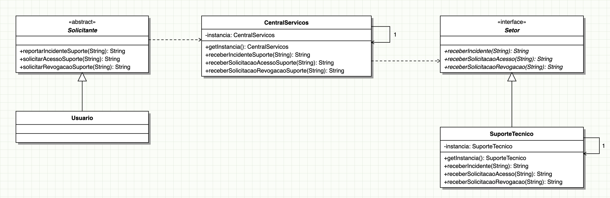

# Mediator — Central de Serviços de TI

Implementação do padrão de projeto **Mediator**, aplicada a uma central de serviços de TI.

## Diagrama UML



Versão editável em Mermaid: [docs/diagrama-uml.md](docs/diagrama-uml.md).

## Como rodar os testes

```
mvn test
```
